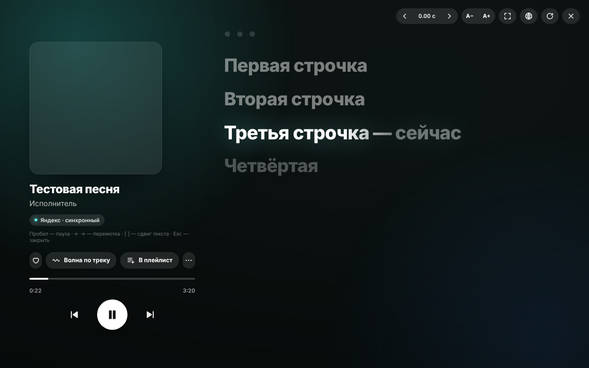

<p align="center"></p>

<h1 align="center">ym-plus</h1>

<p align="center">Синхронные тексты песен и системный плеер для Яндекс Музыки — на Windows и на телефонах vivo (OriginOS)</p>

<p align="center"><a href="https://pay.cloudtips.ru/p/9466c960"></a></p>

> Неофициальный проект. Не связан с Яндексом, Apple, vivo, Musixmatch и другими упомянутыми компаниями.
> Модификация клиента формально противоречит пользовательскому соглашению Яндекс Музыки — используйте на свой риск.

---

## Что внутри

| Папка | Что это |
|---|---|
| [`desktop/`](desktop) | Кнопка «Текст» для **десктопной Яндекс Музыки на Windows**: полноэкранный экран текста с караоке-подсветкой, свой плеер, лайк, «Моя волна по треку», добавление в плейлист |
| [`android/`](android) | **ЯМ Мост** для телефонов **vivo (OriginOS)**: показывает Яндекс Музыку в системном плеере, на «атомном острове» и на экране блокировки — с сердечком и синхронным текстом |

---

## 🖥 Desktop (Windows)



- Кнопка «Текст» поверх Яндекс Музыки; есть текст у Яндекса — показывается он, нет — ищется в **LRCLIB**, **NetEase**, **Genius**
- Подсветка строк «караоке», плавная прокрутка под музыку, фон в цветах обложки, клик по строке — перемотка
- Свой плеер: пауза, треки, перемотка, ♥, «Моя волна по треку», «В плейлист»
- Файлы приложения **не изменяются** — обновления Яндекс Музыки ничего не ломают

**Установка**

1. Установите [Python 3](https://www.python.org/downloads/) (галочка *Add to PATH*)
2. Скачайте `desktop/ym_lyrics.py` и `desktop/ym_lyrics.bat` в одну папку
3. Запускайте Яндекс Музыку через `ym_lyrics.bat`

**Яндекс Музыка мимо VPN.** Если с включённым VPN Яндекс Музыка не работает или урезает каталог — запустите [`desktop/ym-bypass/ym_bypass.bat`](desktop/ym-bypass) (нужны права администратора). Скрипт добавляет маршруты Windows: трафик к сетям Яндекса идёт напрямую, остальное — через VPN. Работает с любым VPN без поддержки исключений, если в нём не включена жёсткая блокировка трафика (kill switch). Маршруты сбрасываются после перезагрузки — запустите скрипт снова; `ym_bypass_off.bat` отменяет.

Горячие клавиши на экране текста: `Пробел` — пауза, `← →` — перемотка, `[ ]` — сдвиг текста, `F` — во весь экран, `Esc` — закрыть, `Alt+L` — открыть.

<details>
<summary>Как это работает</summary>

Скрипт запускает Яндекс Музыку (Electron) с портом отладки Chromium на `127.0.0.1` и через DevTools Protocol встраивает в окно интерфейс. Чтобы показывать тексты самого Яндекса, скрипт использует токен, с которым приложение обращается к своему API; токен хранится только в памяти и никуда, кроме `api.music.yandex.net`, не отправляется. Найденные тексты кэшируются в `%APPDATA%\ym-lyrics`.
</details>

---

## 📱 Android — ЯМ Мост (vivo / OriginOS)

Системный плеер OriginOS (пункт управления, «атомный остров», экран блокировки) показывает только музыкальные приложения из своего списка. Мост берёт трек из Яндекс Музыки и показывает его в системном плеере, а все нажатия отправляет обратно в Яндекс Музыку.

- ⏯ Пауза, треки, перемотка из пункта управления и с острова
- ♥ Сердечко в системном плеере ставит лайк в Яндекс Музыке
- 🎤 Синхронный текст на карточке и острове (LRCLIB → Musixmatch → NetEase)
- 🏝 Островок появляется сам, когда начинает играть Яндекс Музыка
- 👆 Нажатие на островок открывает Яндекс Музыку
- 🔕 Родное уведомление Яндекс Музыки можно спрятать, чтобы плеер в шторке был один
- Root **не нужен**

**Установка**

1. Скачайте APK из [Releases](../../releases). Начните с варианта **apple**; если плеер не появится — попробуйте **hiby**, **kuwo**, **kugou**
2. Установите (разрешите установку из неизвестных источников)
3. Откройте **ЯМ Мост** → дайте доступ к уведомлениям и разрешите работу в фоне
4. **Перезагрузите телефон** и включите трек в Яндекс Музыке

Чтобы vivo не выгружал мост: закрепите его в недавних приложениях (потяните карточку вниз) и разрешите автозапуск.

> Варианты отличаются только именем пакета. Если на телефоне уже стоит настоящее приложение с таким именем (например, Apple Music), выберите другой вариант.

<details>
<summary>Как это работает</summary>

- `NotificationListenerService` получает медиасессию Яндекс Музыки и повторяет её (метаданные, состояние, кнопки) в собственной `MediaSession`; команды пересылаются обратно через `TransportControls`.
- Системный плеер vivo (`com.vivo.musicwidgetmix`) ищет у приложений службу с действием `com.vivo.musicwidgetmix.support.service` и подключается к ней через `MediaBrowser` («кооперативный» протокол). Через него:
  - флаги возможностей — `vivomusicmix.media.metadata.support_event` в метаданных (бит `64` — избранное, `8` — текст);
  - состояние сердечка — `android.media.metadata.RATING` (heart);
  - нажатие ♥ приходит как `setRating(heart)` → мост нажимает кнопку `actionLike` / `actionUndoLike` Яндекс Музыки;
  - текст — LRC в extras сессии: `vivomusicmix.meida.extra.key.action = vivomusicmix.extra.lrc_change`, `vivomusicmix.extra.key.lyric`, `vivomusicmix.extra.key.meidia_id` (опечатки — как у vivo).
- Островок и карточка открывают приложение через его точку запуска; `LaunchActivity` по `getReferrer()` понимает, что её открыла система, и запускает Яндекс Музыку.
</details>

**Сборка**

Нужны JDK 17+ и Android SDK (build-tools 33+, platform android-33). Gradle не используется.

```bash
cd android
ANDROID_HOME=~/Android/Sdk ./build.sh
```

APK появятся в `android/out/`. Ключ подписи создаётся в `android/release.jks` — **не публикуйте его** и храните: обновлять приложение поверх можно только с тем же ключом.

---

## Поддержать проект

Если проект пригодился — можно угостить автора кофе: **[CloudTips](https://pay.cloudtips.ru/p/9466c960)** ☕
Это необязательно, всё останется бесплатным и открытым.

## Источники текстов

[LRCLIB](https://lrclib.net) (открытая база), Musixmatch, NetEase Cloud Music, Genius — через их публичные или неофициальные API. Тексты принадлежат правообладателям и не хранятся в репозитории.

## Лицензия

[MIT](LICENSE)
